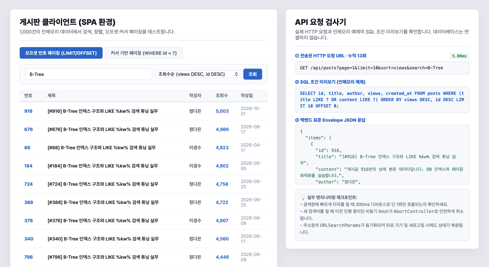
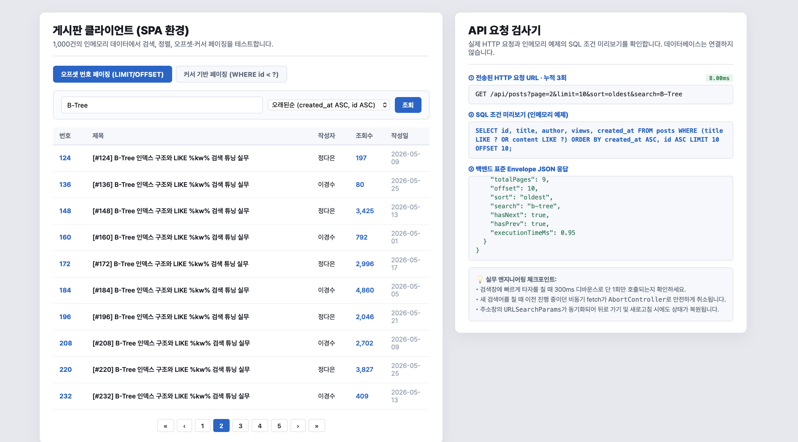
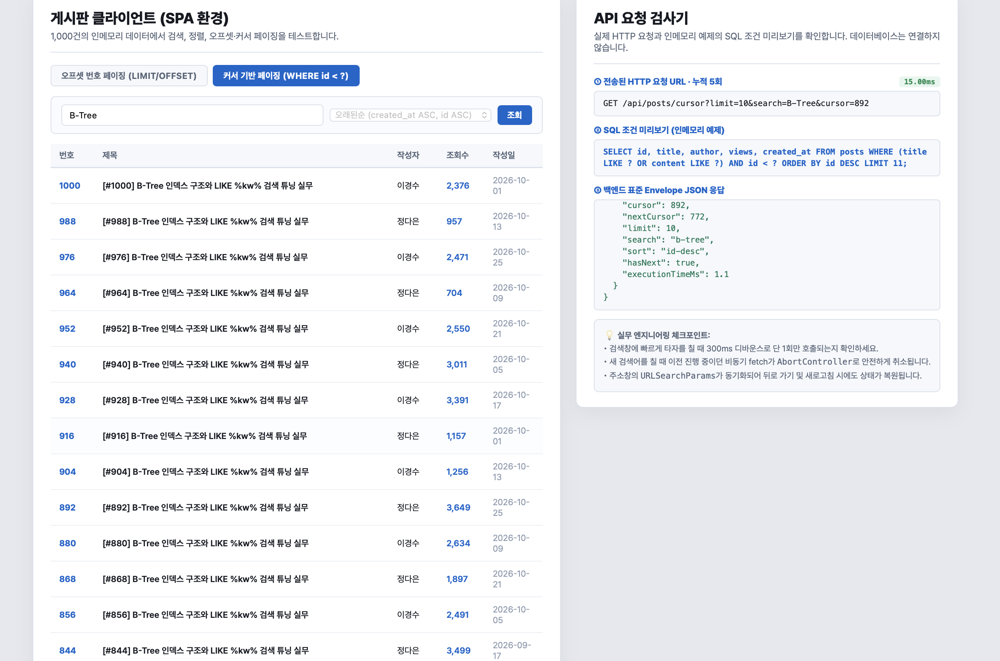
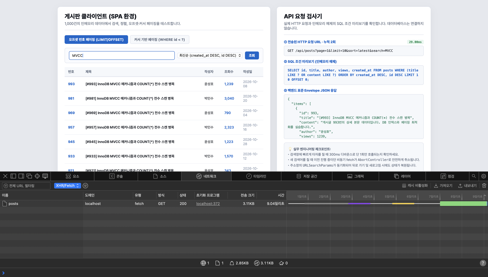
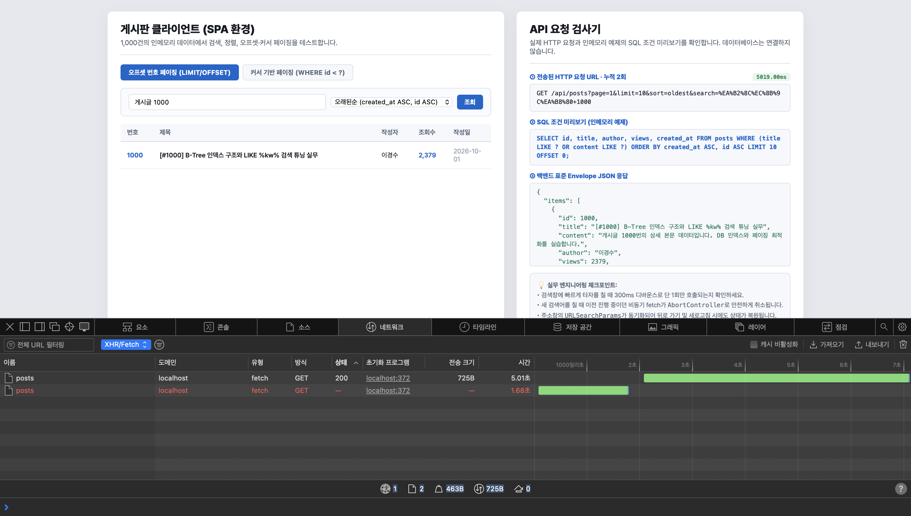

# 09주차 실습 패키지 · 대용량 검색·정렬·페이징 심화 (3학년 전공)

본 실습 패키지는 웹서비스설계 9주차 강의에서 다루는 **1,000건 인메모리 데이터 기반 검색, 정렬, 오프셋·커서 페이지네이션, 프론트엔드 비동기 최적화**의 실행 예제입니다. 실제 데이터베이스나 인덱스는 연결하지 않습니다.

---

## 🚀 빠른 실행 방법

```bash
# 1. 의존성 설치
npm install express

# 2. 백엔드 서버 구동
node server.js

# 3. 브라우저 접속
# http://localhost:3000
```

---

## 📂 파일 구성 및 엔지니어링 특징

### 1. `server.js` (Express 백엔드 API)
- **대량 데이터셋**: 1,000건의 인메모리 게시글 데이터 자동 시드.
- **방어적 파라미터 파싱**: `parseInt(..., 10)` 기수 명시, 잘못된 페이지 보정, `Math.min(..., 100)` 상한.
- **정렬 키 허용 목록**: `Object.hasOwn`으로 허용 키만 적용하고 `__proto__`, `constructor` 등은 `latest`로 처리. 조회수 동점은 `id DESC`.
- **2대 페이징 API 제공**:
  - `GET /api/posts`: 오프셋 기반 페이징 (`LIMIT` / `OFFSET`, 표준 `meta` Envelope 응답)
  - `GET /api/posts/cursor`: 검색·커서 조건 이후 ID 내림차순으로 `limit + 1`개를 확인해 `hasNext` 판단

> 1,000건 인메모리 배열 예제라 커서 API도 배열을 검사합니다. 실제 DB 인덱스의 O(log N) 성능을 입증하지 않습니다.

### 2. `index.html` (SPA 프론트엔드 & 실시간 DevTools 검사기)
- **탭 모드 전환**: [오프셋 번호 페이징] ↔ [커서 기반 무한 스크롤] 즉시 비교.
- **실시간 디바운스 (300ms)**: 연속 타이핑 시 불필요한 API 요청 폭격 방지.
- **AbortController 비동기 방어**: 새 검색어 입력 즉시 이전 fetch를 취소하고, 요청 ID 검사로 이미 도착한 오래된 응답도 무시.
- **브라우저 히스토리 동기화**: `URLSearchParams`와 `history.pushState` 및 `window.onpopstate` 이벤트로 뒤로 가기 / 새로고침 상태 복원 지원.

실시간 검사기는 실제 HTTP URL, 응답 JSON, `X-Response-Time`을 보여 줍니다. SQL은 검색·정렬 조건 미리보기이며 데이터베이스에서 실행하지 않습니다.

---

## 🎯 3학년 전공 실습 과제 체크리스트

1. **정렬 보안**: `server.js`에서 허용되지 않은 정렬 키(예: `sort=views; DROP TABLE--`) 입력 시 안전하게 기본값(`latest`)으로 격리되는지 검증하세요.
2. **커서 페이징**: 검색 조건으로 끝까지 이동해 누락·중복을 확인하세요. `X-Response-Time`은 이 인메모리 예제에서 관찰한 값으로만 기록합니다.
3. **Race Condition 실험**: `index.html`에서 빠른 타이핑 시 콘솔에 `[AbortController] 이전 비동기 요청이 정상 취소되었습니다` 로그가 정상 출력되는지 확인하세요.

---

## 이번 실습의 직접 수정 내용

교수님 제공 예제의 화면과 1,000건 데이터 구조를 유지하며 아래 코드를 보완했습니다.

| 파일 | 기존 예제 | 직접 수정 |
|---|---|---|
| `server.js` 정렬 | `SORT_WHITELIST[sortKey]`로 직접 조회해 상속 키를 안전하게 거르지 못함 | `Object.hasOwn`으로 `latest`, `oldest`, `views`만 통과시키고 `__proto__`, `constructor`와 잘못된 값은 `latest`로 처리 |
| `server.js` 오프셋 API | meta에 `totalCount`와 페이지 정보 일부 포함 | `totalItems`, `offset`, `sort`, `search` 추가. 검색 0건의 `totalPages=0`을 명확히 처리 |
| `server.js` 커서 API | `cursor` 조건만 적용하고 검색은 미지원 | 제목·본문 검색 및 ID 커서 조건을 먼저 적용한 뒤 ID 내림차순 정렬과 `limit+1` 검사 |
| `index.html` 비동기 | 디바운스 타이머가 끝나고 다음 요청을 시작할 때 이전 요청 취소 | 입력 순간 기존 요청 취소, 요청 ID로 오래된 응답 무시, `AbortError` 처리 |
| `index.html` 커서 UI | 검색어가 API로 전달되지 않고 정렬 선택도 가능 | 검색어를 커서 API에 전달, 검색 변경 즉시 누적 목록·커서 초기화, 커서 모드 정렬 비활성화, 마지막에 더 보기 숨김 |

## 페이지네이션 개념 요약

- 오프셋(`offset = (page - 1) × limit`)은 페이지 번호로 특정 위치를 다시 방문하는 게시판·관리자 목록에 알맞습니다. `totalPages = ceil(totalItems ÷ limit)`로 전체 페이지 수를 구합니다.
- 커서는 피드처럼 다음 항목을 이어 보는 화면에 알맞습니다. 이 예제는 `id DESC`를 기준으로 다음 페이지를 찾습니다. 검색어가 바뀌면 누적 항목과 커서를 초기화합니다.
- 디바운스는 마지막 입력 뒤 300ms 동안 추가 입력이 없을 때 검색을 실행해 요청 수를 줄입니다. `AbortController`는 이미 진행 중인 이전 요청을 취소하며 요청 ID 검사는 이미 도착한 오래된 응답이 화면을 덮지 않게 합니다.
- 커서 API는 검색·커서 조건을 먼저 적용한 뒤 `limit + 1`건을 확인합니다. 한 건이 더 있으면 `hasNext=true`로 알리고, 추가 확인용 한 건은 화면 데이터에서 제외합니다.

빈 결과에서는 `totalItems=0`, `totalPages=0`, `offset=0`을 반환합니다. `page=0`, 음수, 숫자가 아닌 페이지는 1로 정규화하고, 초과 페이지는 마지막 유효 페이지로 제한합니다. `limit`은 기본 10, 최대 100입니다.

## 실행 후 직접 확인할 항목

보고서의 API·브라우저 기능 확인과 실제 캡처는 `REPORT.md` 및 `screenshots/`에 있습니다. 300ms 미만 간격 입력 테스트와 지연 응답 중 이전 요청을 취소하고 최종 결과를 반영하는 테스트를 직접 확인했습니다. `node_modules`는 Git에 올리지 않습니다.

느린 응답을 재현하려면 서버를 `SIMULATED_API_DELAY_MS=5000 node server.js`로 실행합니다. 이 값은 테스트할 때만 사용하며 기본 실행에서는 지연이 없습니다.

## AI 활용

AI로 구현 수정과 보고서 초안을 작성했습니다. API 경계값·정렬·검색·커서 전체 탐색과 브라우저 동작은 직접 실행해 검증했습니다. 확인한 테스트 입력 및 캡처는 `REPORT.md`에 정리했습니다.

## 테스트 캡처

### 1. 검색 및 조회수순 정렬



### 2. 오프셋 페이지 2



### 3. 커서 검색 및 더 보기



### 4-1. MVCC 디바운스 요청 1회



### 4-2. 지연 응답 중 이전 요청 취소


