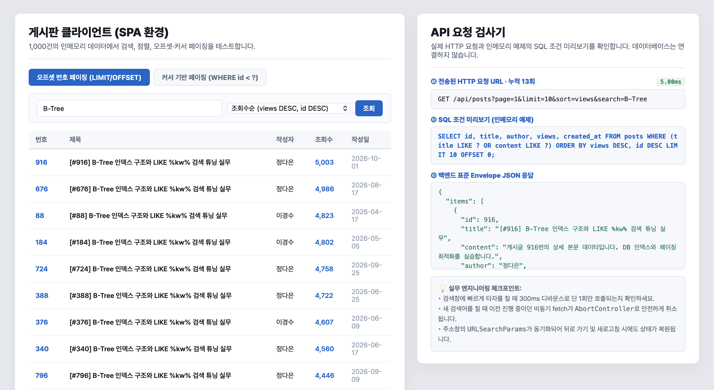
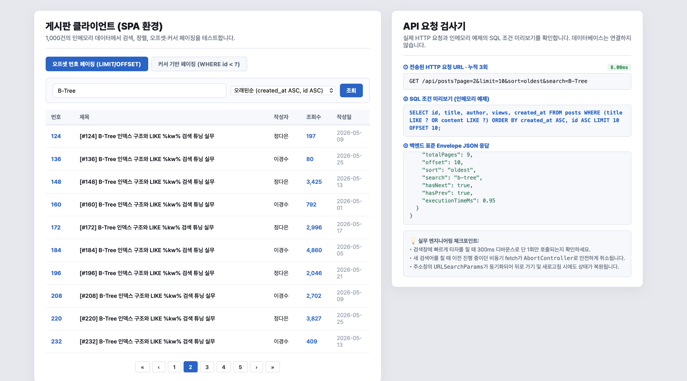
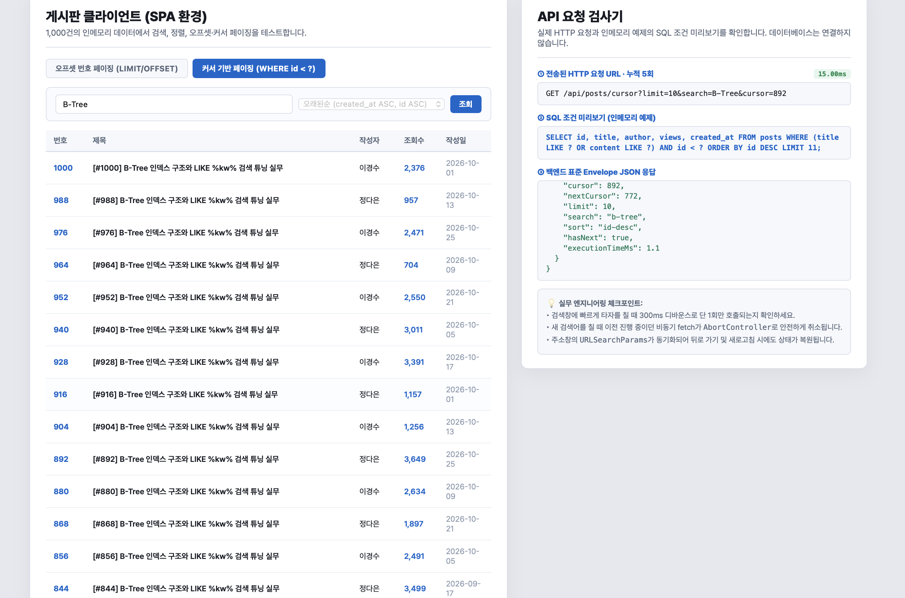
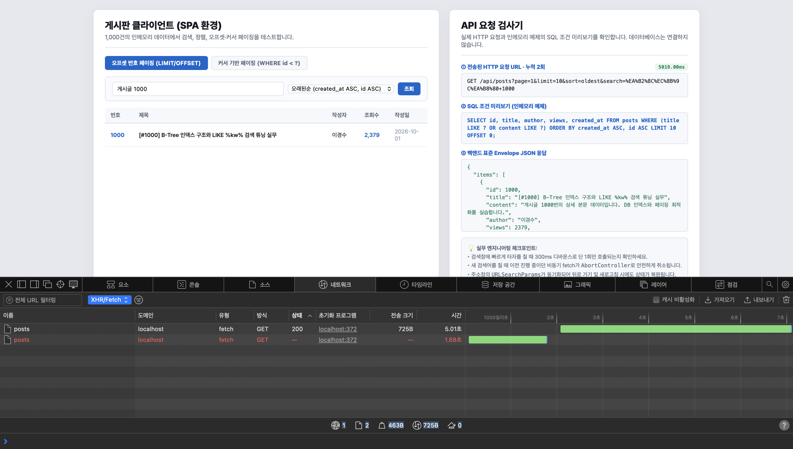

# 실습 보고서 · WEEK 09 실습 2

## 실행 환경

- 예제: 교수님 제공 `실습코드/index.html`, `server.js`, `README.md`
- 실행: `npm install express` 후 `node server.js`, 브라우저에서 `http://localhost:3000`
- 데이터: 1,000건 인메모리 게시글
- 직접 수정본은 이 폴더의 `index.html`, `server.js`, `README.md`입니다.

## 원본과 비교한 직접 수정 내용

| 원본 코드 | 수정 내용 | 이유 |
|---|---|---|
| 서버가 `SORT_WHITELIST[sortKey]`를 바로 가져옴 | `Object.hasOwn`으로 세 정렬 키만 허용하고 상속 속성 포함 잘못된 값은 `latest`로 대체 | `__proto__`, `constructor` 등이 상속 속성으로 처리되는 문제 차단 |
| 오프셋 meta는 `totalCount`, 페이지 수 등 일부 필드만 제공하고 빈 결과도 `totalPages=1` | `totalItems`, `offset`, `sort`, `search` 추가, 빈 결과는 `totalPages=0`·`offset=0`, 안전한 페이지 범위 처리 | 요구한 meta 및 빈 결과 의미 명확화 |
| 커서 API는 `cursor`만 필터링 | 제목·본문 검색과 커서 조건을 모두 적용한 후 ID 내림차순으로 정렬, 그 뒤 `limit + 1` 확인 | 검색 결과에서 누락 없이 커서 이동 |
| 화면은 커서 모드에서도 정렬 선택이 활성화됨 | 커서 모드에서 정렬 선택 비활성화. 탭에 ID 조건을 표시 | 커서 API 정렬은 `id DESC` 고정 |
| 검색 디바운스 만료 시점에 `loadData`가 이전 요청을 취소 | 입력 시 즉시 `AbortController.abort()`, 요청 ID 확인으로 오래된 응답 무시, `AbortError` 분기 | 검색어 입력 뒤 늦게 도착한 이전 결과가 화면을 덮지 않도록 방어 |
| 커서 검색어를 API 요청에 전달하지 않음 | cursor endpoint에 `search` 전달, 검색 입력 즉시 누적 목록·cursor 초기화 | 새 검색 조건에서 앞 검색의 결과와 커서를 섞지 않음 |
| 마지막 cursor 응답 뒤 더 보기 버튼은 disabled 상태로 남음 | `hasNext=false`면 더 보기 영역 숨김 | 더 가져올 항목이 없음을 분명히 표시 |
| 원본의 검색 입력은 자동 검색과 별도 조회 버튼이 함께 있음 | 기존 UX는 유지하고 두 방식 모두 1페이지부터 검색하도록 처리 | 직접 조회 동작과 실시간 디바운스 양쪽에서 조건 초기화 |

## 요구사항 검증 결과

| 테스트 | 기대 결과 | 실제 결과 |
|---|---|---|
| `search=B-Tree` (제목), `search=게시글 1000` (본문) | 제목·본문 어느 쪽이든 검색 | 제목 검색 84건, 본문 검색 1건(ID 1000) 확인 |
| 검색어 `검색결과없음` | 빈 데이터와 빈 상태 안내 | API에서 `items=[]`, `totalItems=0`, `totalPages=0`, `offset=0` 확인; 브라우저 빈 안내 확인 |
| `sort=latest`, `oldest`, `views` | 최신 ID, 오래된 ID, 조회수 내림차순 | 최신 첫 항목 ID 1000, 오래된 첫 항목 ID 1, 조회수 비증가 확인 |
| 조회수 동점 | 동점 내 `id DESC` | 응답 전 구간 동점 타이브레이커 확인 |
| `sort=__proto__`, `constructor`, 임의 문자열 | `latest` fallback | `meta.sort=latest`, 첫 ID 1000 확인 |
| `page=1&limit=10` | 첫 10건, offset 0, meta 정확 | `totalItems=1000`, `totalPages=100`, `offset=0` 확인 |
| `page=100&limit=10` | 마지막 페이지의 나머지 데이터, `hasNext=false` | `offset=990`, 10건, `totalPages=100`, `hasNext=false` 확인 |
| `page=0`, `page=-1`, `page=abc` | 1페이지로 보정 | 세 입력 모두 `meta.page=1` 확인 |
| `limit=1000` | 최대 100으로 제한 | `meta.limit=100`, 100건 확인 |
| 검색 또는 정렬 변경 | offset page 1부터 재조회 | 오래된순 변경 시 1페이지 결과, 검색 변경 시 1페이지 적용 확인 |
| cursor 검색 `search=B-Tree&limit=10` | 제목·본문 일치만 반환, `hasNext=true` | 10건, `sort=id-desc`, 다음 cursor 892 확인 |
| cursor 더 보기 한 번 클릭 | 기존 10건 뒤 다음 10건 추가 | 누적 10→20건, 두 번째 묶음 ID는 880부터 하향 확인 |
| cursor 끝까지 이동 (`search=게시글&limit=37`) | ID DESC 누적, 누락·중복 없음 | 1,000건을 28페이지로 순회, 1,000개 고유 ID 및 ID 내림차순 확인 |
| 커서 검색 `search=없는문구` | 더 보기 숨김 | 결과 0건, `hasNext=false`, 더 보기 숨김 확인 |
| 누적 중 검색어를 `게시글 1000`으로 변경 | 이전 목록·cursor 초기화 | 이전 20건 제거 후 새 검색 결과 ID 1000 한 건 표시, 다음 요청 버튼 없음 |
| 페이지 이동 후 뒤로 가기 | URL·입력·정렬·페이지·목록 일치 | page 2에서 page 3으로 이동 후 뒤로 가기에서 page 2와 해당 목록 복원 확인 |
| URL 조건으로 새로고침 | URL의 조건 복원 | `search`, `sort`, `page`를 입력창·select·목록에 반영 확인 |
| 입력 간격 300ms 미만 타이핑: `M`, `V`, `C`, `C` | 디바운스 후 요청 1회 | 초기 조회 뒤 입력을 빠르게 이어서 `MVCC`를 검색. 누적 횟수는 1에서 2로 1 증가했고, 네트워크 목록에는 `search=MVCC` 요청 1개만 표시 |
| 느린 응답 중 검색어 교체 (`SIMULATED_API_DELAY_MS=5000`) | 이전 요청 취소, 마지막 검색어 결과 표시 | Safari 네트워크 탭에서 `MVCC` 요청은 상태 `—`로 끝나 응답 헤더가 없었고, 후속 `게시글 1000` 요청은 200으로 완료. 최종 결과는 ID 1000 한 건. 클라이언트 경과시간 약 5,019ms |

## 관찰 응답 시간

서버 `X-Response-Time`과 화면 latency 배지의 관찰값: 주요 API 호출의 서버 측 측정 0.03–0.64ms, 브라우저 요청 배지 2.90–17.60ms. 이는 로컬 환경의 단일 관찰값이며 DB 인덱스 성능 입증을 의미하지 않습니다.

## 개념 설명

1. 오프셋은 게시판처럼 페이지 번호로 특정 위치로 돌아가야 할 때 적합합니다. `offset = (page - 1) × limit`, `totalPages = ceil(totalItems ÷ limit)`입니다.
2. 커서는 피드나 더 보기처럼 다음 결과를 이어 읽을 때 적합합니다. 이 구현은 ID 내림차순으로 고정하고 마지막 ID보다 작은 ID를 다음 요청에서 조회합니다.
3. 디바운스는 입력이 멈춘 뒤 300ms 후 검색해 요청 수를 줄입니다. AbortController는 이미 진행 중인 요청을 취소하고 요청 ID 검사는 이미 반환된 오래된 응답이 최신 화면을 덮지 못하게 합니다.
4. 검색과 cursor 조건을 적용한 결과에서 `limit + 1`개를 확인합니다. 추가 1건이 있으면 `hasNext=true`, 실제 화면에는 앞의 `limit`건만 보냅니다.

## 강의자료 반영

제공된 9주차 강의자료에서 검색→정렬→페이지 범위 선택(8쪽), 검색 변경 시 첫 페이지와 더 보기 누적 목록 초기화(11–12쪽), URL 상태 복원(21–22쪽), 기존 목록 뒤에 이어 붙이기(23–25쪽), 화면 방식 선택(29쪽), 응답 역전 방지(32–35쪽), 300ms 디바운스(36–38쪽), 접근성 안내(39쪽)를 참고했습니다.

## 테스트 캡처

아래 캡처는 실제 실행 화면입니다. 디바운스 캡처에서는 `MVCC` 연속 입력 후 누적 요청이 1회 증가하고 네트워크 목록에 해당 요청 한 건만 남은 것을 확인할 수 있습니다. `4-2`는 5초 서버 지연 중 이전 요청이 중단된 네트워크 기록입니다.

### 1. 검색·조회수순 정렬

### 2. 오프셋 페이지 2와 URL·meta

### 3. 커서 검색·더 보기

### 4-1. 빠른 입력 후 검색 요청 1회

### 4-2. 지연 응답 중 이전 요청 취소

## AI 활용 고지

AI로 원본 코드 분석, 기능 수정, README와 보고서 초안을 작성했습니다. 서버 API 경계값·검색·정렬·cursor 전체 탐색, 브라우저 페이지 이동·뒤로 가기·새로고침·커서 검색 초기화, `MVCC` 연속 입력 후 검색 요청 1회 발생을 직접 실행해 확인했습니다. 또한 5초 지연 응답 중 검색어를 바꾸어 네트워크 탭에서 이전 `MVCC` 요청이 상태 `—`로 종료되고 최종 검색 요청이 200으로 끝나는 것을 확인했습니다. 첨부 캡처는 직접 실행한 화면입니다.
